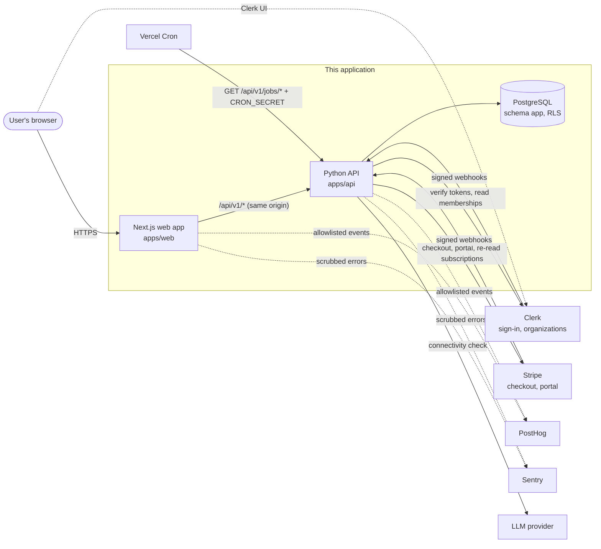
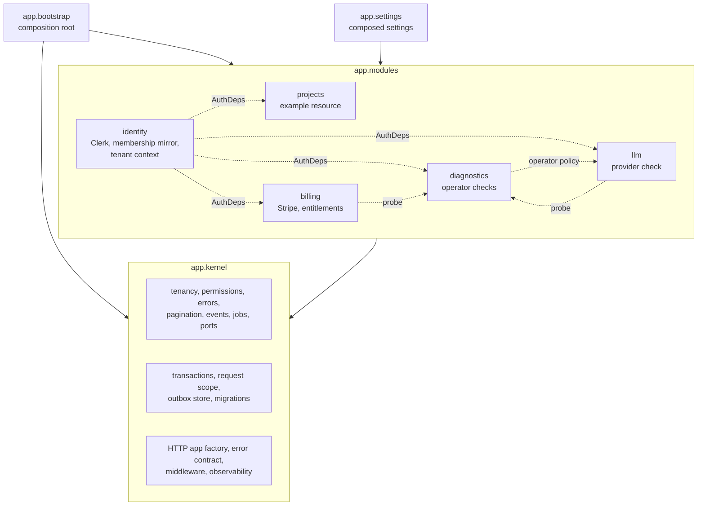
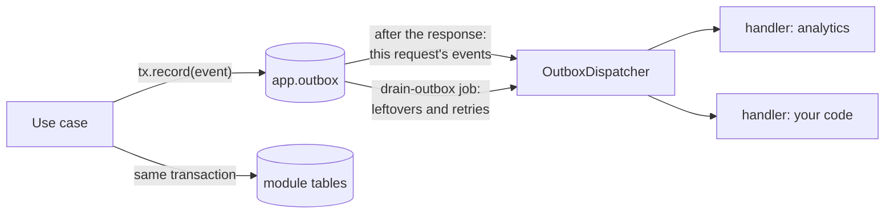
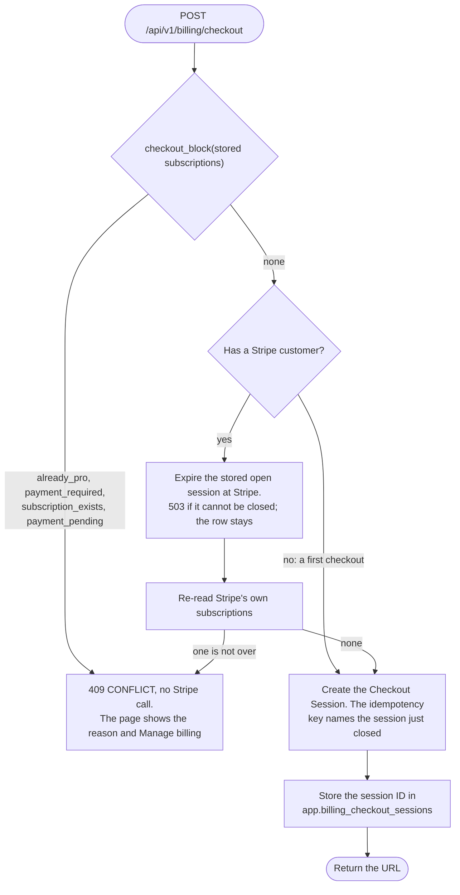
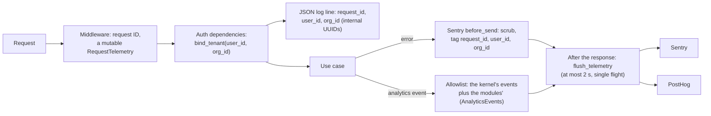

# Architecture

This document describes how the template is built and how to extend it. The decisions behind it are in [ADR-0001](../dev-docs/adr/0001-approved-recommendations.md) (stack, data access, tenancy, billing policy) and [ADR-0003](../dev-docs/adr/0003-modular-architecture.md) (modular monolith, transactions, events, jobs, generator). [ADR-0004](../dev-docs/adr/0004-cycle-1-adopted-decisions.md) records the later decisions that agents adopted by delegation and the owner has not yet confirmed: the Vercel topology, the database login role, page protection, capability flags, and configuration. Requirements are in the [engineering specification](../dev-docs/engineering-implementation-plan.md).

Paths that start with `app/` or `tests/` are under `apps/api`, and paths that start with `src/` or `e2e/` are under `apps/web`.

## Principles

- **Secure by default.** Every API operation is authenticated and authorized on the server. Tenants are isolated twice: by the application, and by forced PostgreSQL row-level security (RLS) under non-privileged database roles.
- **A modular monolith.** One deployable API, split into feature modules with explicit boundaries. Modules depend on a shared kernel, never on each other's internals. Splitting a module into its own service later is possible, but not a goal.
- **Ports and adapters.** Use cases depend on protocols. SQL, SDKs, and fakes live in adapters, and the composition root picks the adapters per environment.
- **Boundaries are enforced by tooling, not convention.** Import contracts, architecture tests, query-count budgets, and contract-drift checks fail CI when a boundary is crossed (see [Fitness functions](#fitness-functions)).
- **Measured, not guessed.** Performance choices follow the local measurements in `dev-docs/evidence/`. Targets are each adopter's decision (DEC-003).

## System context



The browser never talks to the database or to Stripe with secret keys (FE-02, DEC-008).

## Containers

| Container | Runs | Holds | Notes |
|---|---|---|---|
| Web app (`apps/web`) | Next.js 16 App Router: Vercel serverless and the browser | Presentation only | Same-origin `/api/v1/*`: under Vercel Services the platform's route table sends it to the API, and `next.config.ts` rewrites it to `API_ORIGIN` for local development. Clerk UI. Generated, typed API client. Pages are static shells that load their data in the browser ([Frontend](#frontend)). |
| API (`apps/api`) | FastAPI on Python 3.12 (ASGI) | All business rules | Stateless; one process serves concurrent requests. Deployed as one Vercel project with Services (the root `vercel.json`; Beta); platform behavior is NOT VERIFIED (DEC-001). |
| PostgreSQL | Local Docker, or Supabase through its transaction pooler | All application state | The API logs in as `app_login` and switches to one of two runtime roles (`app_api`, `app_worker`) in every transaction. Forced RLS, transactional outbox. |
| Vercel Cron | Platform scheduler | Nothing | Calls the job endpoint (the `crons` of the root `vercel.json`). |

## API components



Dotted arrows are contracts that the composition root passes in. No module imports another module for them:

- **`AuthDeps`** (kernel contract, implemented by identity): FastAPI dependencies that authenticate the caller and resolve the personal or organization context.
- **`IntegrationProbe`** (kernel contract): each module that owns an integration contributes a probe, and diagnostics receives the list.
- **Operator policy:** `DiagnosticsService.may_use`, handed to the `llm` routes as a function. `POST /api/v1/llm/check` answers 404 to every caller it refuses, so the route and the Integrations page apply one policy.
- **Events:** modules publish to the outbox and subscribe to the event types they care about.

### Module catalogue

| Module | Owns | Routes | Jobs | Events |
|---|---|---|---|---|
| `identity` | Users, the organization-membership mirror, Clerk token and webhook verification, tenant-context resolution | `/me`, `/webhooks/clerk` | `reconcile-memberships` | publishes `identity.user_deleted` (through its `api.py`) |
| `billing` | Customers, subscriptions, the entitlement matrix, price catalog, the open Checkout Session per user, Stripe | `/entitlement`, `/billing/*` (status, checkout, portal, sync), `/pro/insight`, `/webhooks/stripe` | `reconcile-billing` | publishes `billing.entitlement_changed`; handles `identity.user_deleted` |
| `projects` | Example tenant-scoped resource; the generator's reference | `/projects`, `/orgs/{org_id}/projects` | — | publishes `projects.created` |
| `llm` | Provider-agnostic connectivity check with cost bounds, for operators | `/llm/check` | — | — |
| `diagnostics` | Operator-only integration report and checks, and the answer to "may I use them?" | `/diagnostics/*` (`/diagnostics/access` answers any signed-in caller) | — | — |
| kernel | Health, readiness, outbox, rate limits | `/health`, `/ready`, `/jobs/{name}` | `drain-outbox`, `prune-expired` | dispatches all |

## Module anatomy

Every module has the same files, which is what lets `pnpm new:module` generate one and lets tooling check them:

| Layer | File | May import | Never imports |
|---|---|---|---|
| Wiring | `module.py` | everything in the module, the kernel | other modules (except their `api`) |
| Settings | `settings.py` (optional) | kernel config | anything else in the module |
| Public API | `api.py` (optional) | lower layers | — |
| HTTP | `routes.py` | service, domain, kernel HTTP contracts | adapters, SDKs, kernel infrastructure |
| Adapters | `adapters.py` or `adapters/` | ports, domain, drivers and SDKs | service, routes |
| Probe | `probe.py` (optional) | service, ports, domain | frameworks, adapters |
| Use cases | `service.py` | ports, domain, kernel ports | frameworks, SDKs, adapters, kernel infrastructure |
| Ports | `ports.py` (optional) | domain | everything above |
| Domain | `domain.py` | kernel core only | frameworks, Pydantic, SDKs, everything above |

`module.py` returns a `Contribution`: routers, integration probes, the analytics events the module sends, and closers. The composition root collects them, so a module that adds a probe or an event edits no shared file. `domain.py` of a module that lists a resource also declares `Capabilities`, what the caller may do with it ([Capability flags](#frontend)).

Rules between modules:

- A module may import another module **only** through its `api.py`. Prefer kernel contracts (`AuthDeps`, events, probes) over direct calls.
- Modules form no import cycles.
- The kernel never imports a module.

## Request lifecycle

An organization-scoped list, `GET /api/v1/orgs/{org_id}/projects`:

```mermaid
sequenceDiagram
  autonumber
  participant B as Browser
  participant M as Middleware
  participant S as Request scope
  participant A as AuthDeps (identity)
  participant P as ProjectService
  participant DB as PostgreSQL (app_api)
  B->>M: GET + Bearer token
  M->>M: request ID, body limit, CORS
  M->>A: verify token (cached Clerk keys; no network with PEM)
  A->>S: admitted: begin request transaction (lazy)
  A->>DB: BEGIN, set role + context, find user
  A->>DB: read my membership (same transaction)
  alt membership older than 300 s, or missing and not answered from the mirror
    A->>S: release() before calling Clerk
    A->>A: refresh memberships from Clerk (worker pool)
  end
  A->>P: TenantContext(org, role)
  P->>P: authorize(project:read)
  P->>DB: set org context, keyset query
  S->>DB: COMMIT (before the response is sent)
  S-->>B: 200 JSON
  Note over S,DB: After the response: dispatch any events this request recorded
```

Errors anywhere map to RFC 9457 problem details with a stable `code` and the request ID. Stack traces, SQL, and secrets never reach the client.

## Data access

**Roles.** The API logs in as `app_login` (migration `20261030000010`; `pnpm db:api-login` gives it a login and a password). It owns nothing, holds no privilege of its own, and is `NOINHERIT`, so a query that does not switch role reads nothing in schema `app`. Requests run as `app_api` and system work runs as `app_worker`; neither owns tables or has `BYPASSRLS`. Each transaction switches to one of them and sets the statement timeout and the full tenant context (`app.clerk_user_id`, `app.user_id`, `app.org_id`) in **one statement**, which is one round trip. Migrations, seed, reset, and `api-login` connect as the schema owner through `MIGRATION_DATABASE_URL`, which the running API never reads.

**Login identity.** In preview and production the first transaction of each process checks `session_user`. A superuser, a role with `BYPASSRLS` or `CREATEROLE`, a member of such a role, or an owner of a table in schema `app` makes every database transaction fail with a 503 that names the fix, and `/ready` reports not ready; a process that was refused keeps refusing until it restarts. Local and test may log in as a superuser. The limit (DB-11): `app_login` can still `SET ROLE app_worker`, whose policies let every row through on several tables, so code that runs arbitrary SQL can read across tenants. Row-level security does not stop SQL injection.

**Faults.** The server enforces the statement timeout, so it cannot end a call when the server, or a pooler in front of it, stops responding. Every round trip, including `COMMIT` and `ROLLBACK`, therefore also has a client-side deadline (statement timeout plus connect timeout); past it, the connection is closed and the call fails with `503`. A `503` from a failed `COMMIT` means the outcome is unknown: the server may have committed before the connection failed. So a client should re-read before it retries a create, and a mutation with external side effects takes an idempotency key (API-05). A pooled connection that died while idle (after a pooler restart or failover) fails on its first round trip, before any work has run, so the transaction starts again on another connection. TCP keepalives (probing after 30 s idle, about a minute to detect) notice a peer that vanished without closing the connection, so an idle connection to it is also replaced on first use instead of waiting out the deadline. Transaction-mode pooling works because every setting is transaction-local and prepared statements are off. The DEC-001 proof checked this through PgBouncer in transaction mode.

**`Transactions[R]`.** Each module gets transactions that build its own repository: `kernel.transactions(PgProjectRepository)`. A block yields a `Tx` with:

- `tx.repo`: the module's repository;
- `tx.record(event)`: writes to the outbox in the same transaction;
- `tx.audit(entry)`: appends to the audit log;
- `tx.lock_my_role(org_id)`: re-reads and locks the caller's role before a privileged write (TEN-07, NT-06).

**Request-scoped transactions.** Routers that touch only the database opt in. Their whole request is one `app_api` transaction:

- every block in the request joins it;
- the context is re-applied only when it changes;
- a block that raises rolls the request back. The earlier blocks' work is gone, so a later block is refused, and a handler that catches the error and returns anyway gets a 500, never a success for work that was rolled back. Let errors from a block propagate;
- a block whose transaction can no longer commit fails instead of ending as a success. This holds for every transaction, scoped or not, and covers two cases. A statement error caught *inside* the block: PostgreSQL would turn the `COMMIT` into a silent `ROLLBACK`, so the block raises an error (a 500). A lost connection caught inside the block (the server ended the session, a pooler restarted, a deadline closed it): psycopg would leave the block without a `COMMIT` and without an error, so the block raises a 503 and nothing is committed. The commit checks this again. To try a statement and carry on after it fails, wrap it in a savepoint (`conn.transaction()`); this recovers from a statement error, never from a lost connection;
- it commits after the handler returns, **before** the response is sent, so a failed commit is a 503, never a false 201. It also commits when the handler raises a domain error (a 4xx, or a 503 the service chose), so an expected outcome keeps its writes, such as the audit entry of a denied action (NT-07). Any other exception (a bug, a cancelled request) rolls it back, so a 500 never comes with committed writes or outbox events. The commit or rollback is shielded from cancellation, so a client that disconnects cannot leave the transaction open;
- `Transactions.release()` commits early and **ends** the scope: the rest of the request runs as ordinary short transactions. The identity resolver calls it before contacting Clerk. Calling it inside a block is refused, because the block still uses the connection.
- **Admission and threads.** A scoped request holds its connection across several threadpool hops and needs a thread for each. Each process runs blocking work on `REQUEST_THREADS` (40) threads, set explicitly at startup. To keep connection holders from starving behind threads that wait for a connection:
  - at most `DATABASE_POOL_MAX_SIZE` scoped requests are admitted at once (one gate per event loop; an ASGI server runs one per process), and the rest wait asynchronously, holding no thread. The token is verified before admission, so a bad token never takes a place. `release()` gives the place back, so a request waiting on Clerk for memberships never holds up other requests;
  - admission covers scoped requests only. Everything else that uses the API pool (unscoped routes such as checkout, the portal, LLM, and diagnostics, and every block after `release()`) waits for a connection on a pool thread instead. At most `REQUEST_THREADS − DATABASE_POOL_MAX_SIZE` threads may wait at once; past that, the call fails at once with a 503 and holds no thread. So threads waiting for API connections plus admitted scoped requests never exceed `REQUEST_THREADS`, and a scoped holder always finds a thread for its next hop once running work finishes. Running work includes slow external calls, which hold threads too, so those calls must stay bounded by their own timeouts and concurrency limits;
  - the commit runs on its own thread limiter;
  - nested blocks inside a request transaction are refused.

  Under local stress with a 5-connection pool, this took the API from 3% failures and 55 s worst-case latency to no failures and a 1.6 s worst case.

Routes that call external services use explicit short transactions instead: checkout, the portal, LLM, diagnostics, and webhooks.

**Two pools per process.** `DATABASE_POOL_MAX_SIZE` serves `app_api` and `DATABASE_WORKER_POOL_MAX_SIZE` serves `app_worker`. A request holding an API connection that needs worker work (a rate-limit counter, a membership refresh) draws from the other pool, so the pools can never deadlock each other.

**Query budget.** Every key endpoint is tested to issue at most 8 statements, independent of data volume (ARCH-08); the membership refresh is a fixed 8 round trips for any number of memberships. PERF-07 (local, 20 ms added per round trip) showed why this matters with a remote database. A personal list took a median of 686 ms with per-setting setup statements, 180 ms after single-statement setup, and 135 ms with the request-scoped transaction. An organization list went from 1,049 ms to 270 ms to 180 ms. Evidence is in `dev-docs/evidence/`.

## Domain events and the outbox



- **Exactly-once recording.** An event row exists if and only if its transaction committed.
- **At-least-once handling.** Handlers run after commit, and a retry re-runs every handler for that event. Make handlers idempotent: key side effects by `event.id`, or make them naturally idempotent.
- **Concurrency.** Events are leased with `FOR UPDATE SKIP LOCKED`, so after-response dispatch in many instances and the job can drain together. Each event is leased just before its handlers run, one at a time, so a lease covers exactly one event; its outcome is committed as soon as its handlers finish. A lease (`OUTBOX_LEASE_SECONDS`, default 900 s) lasts longer than a function the root `vercel.json` configures may run (Vercel's default is 300 s and its generally available maximum 800 s; the 1800 s beta is per function and not used here: [operations.md](operations.md#outbox)), so it expires only when its worker is gone: the process died, or the platform stopped the function. Completion is fenced to the lease: a worker whose lease expired records nothing, and is counted as `superseded`.
- **Failures.** Retries use exponential backoff (2^attempt seconds, capped at an hour). After `OUTBOX_MAX_ATTEMPTS` the event is marked `dead` and kept for inspection. Every drain, after-response dispatch included, first records each expired lease the same way, as a failed attempt: a retry after backoff, or `dead` after the last attempt. Only pending events with attempts left are leased, so no event runs more than `OUTBOX_MAX_ATTEMPTS` times, and an event that crashes its worker goes behind the events already due instead of blocking them. If `OUTBOX_MAX_ATTEMPTS` is lowered, the `drain-outbox` job marks pending events that already used up the new limit as `dead`.
- **Retention.** `prune-expired` deletes processed events after `OUTBOX_RETENTION_DAYS` (default 7), because payloads hold internal user IDs.
- **Ordering.** Not guaranteed across events. Handlers must not assume an order.
- **Payloads.** Internal IDs and small facts only: no personal data beyond IDs, no secrets.

To react to an event, subscribe in your module's `module.py`:

```python
kernel.handlers.subscribe(ProjectCreated, "notifications.welcome", service.on_project_created)
```

## Jobs

Jobs are registered in code (`kernel.jobs.register(Job(...))`), and every job must be safe to repeat and to run concurrently with itself. They run through:

- the CLI: `uv run python -m app.cli job` lists jobs, and `job <name>` runs one;
- `GET /api/v1/jobs/<name>` with `Authorization: Bearer <CRON_SECRET>`. This is what Vercel Cron calls, from the `crons` of the root `vercel.json`. A test fails if that file drifts from the registry.

Without `CRON_SECRET`, the endpoint returns 404. Over HTTP a job runs once at a time across all instances, and no sooner than `JOB_MIN_SPACING_SECONDS` after its previous start: the run claims its row in `app.job_runs` with one statement, and releases it with another, so nothing is held while the job runs and a transaction pooler is no obstacle. A call that finds the job running gets 409; one that comes too soon gets 429 with `Retry-After`. The CLI is not guarded. Default schedules are daily, which a Hobby project can run. Hobby restricts a project to non-commercial, personal use ([Hobby plan](https://vercel.com/docs/plans/hobby), updated 2026-09-14) and fires a daily cron anywhere within its scheduled hour ([cron usage and pricing](https://vercel.com/docs/cron-jobs/usage-and-pricing), updated 2026-07-15), so a commercial launch needs a plan that allows it, and on plans that allow it you can run `drain-outbox` more often. Vercel Cron invokes production deployments only. Every job bounds its work per run: open-ended work (`drain-outbox`, `prune-expired`) stops after 60 s, and the reconciliation jobs check a fixed-size batch, least recently checked first; the next run continues.

## API conventions

- **Errors.** A module declares an error next to its domain: a `DomainError` subclass with a `code` and a `status` (a 4xx, or 503 for a dependency or configuration failure); any other status makes the class impossible to define. The kernel maps it with no edit (`app/kernel/http/problem.py`). The request transaction keeps its writes for such an error, so an expected outcome keeps its audit entry, and rolls back for anything else. A bare `DomainError` is a 500. A 5xx `DomainError` is reported to Sentry from the error handler, tagged with its `error_code`, at most once a minute per cause per instance; `NOT_CONFIGURED` is a warning, except a key or request the provider refuses (`ProviderRejectedError`, the same answer), which is an error. Anything that is not a `DomainError` is a plain exception: 500, rolled back, reported through the ERROR log.
- **Authorization.** Every protected route declares what authorizes it: `dependencies=[requires(PERMISSION)]` with a `Permission` the module registers in its domain, or an `Access` kind (`OWN_ACCOUNT`, `ANY_MEMBER`, `OPERATOR`) for a route no permission governs. The use case still decides, inside its transaction, with `authorize()` (and writes the audit entry of a denial). A declared `Permission` that the request never evaluates answers 500 and rolls back, so a forgotten `authorize()` fails closed. The route-manifest test (`apps/api/tests/integration/test_platform.py`) fails a route with no declaration, two, a permission no module registers, or an access kind that does not fit its path.
- **Contract.** A route declares its errors on its router with `responses=errors(...)` (`app/kernel/http/schemas.py`). `packages/contracts/openapi.json` is generated from the routes, and a test session fails when any response differs from it in status, content type, or body (`apps/api/tests/openapi_contract.py`). A test that makes a route raise an error it cannot raise is marked `contract_exempt`.
- **Sessions someone else started.** A Clerk impersonation, an actor token, or an agent task carries an `act` claim. The API refuses it with 403 unless `CLERK_ALLOW_IMPERSONATION=true`; then every audit entry names the actor (`app.audit_log.impersonator_clerk_id`) and diagnostics answer 404 to the session.
- **Composition fails loudly.** `build_container` raises for an adapter override no builder read; `load_settings` raises for a keyword that names no setting; two probes for one integration raise at startup; no two settings classes may read one environment variable. `tests/architecture/test_layer_imports.py` allowlists the imports of each layer, so a package that no import-linter contract names cannot enter a domain, service, probe, or route.

## Billing: checkout and synchronization

Entitlement comes only from synchronized billing records that originate in verified Stripe data (BILL-02): signature-verified webhooks, reconciliation, and a re-read that the signed-in user requests for their own customer (`POST /api/v1/billing/sync`). A redirect parameter never grants Pro. Checkout refuses to buy a second subscription (BILL-07, DEC-013 option B, adopted by delegation):



- The stored row holds the session ID, the request key, and the expiry, never the URL, and only the API role reads or writes it.
- The success page polls the billing status and, after 3 s, asks the server once to re-read; the portal returns to `/billing?from=portal`, where the page asks once. The re-read counts against the per-instance Stripe-call bound that checkout and the portal share, never waits, never takes the last synchronization slot (so webhooks and reconciliation keep one), and is limited per user. If it fails, the page keeps polling.
- The template never creates or changes the Customer Portal configuration; the `/integrations` Stripe check reads it. The webhook endpoint must use the **Snapshot** payload format: a Thin event is answered `400 INVALID_REQUEST` with a message that says so.
- When Clerk reports `user.deleted`, identity records `identity.user_deleted` with the revocation; billing handles it after commit and asks Stripe to end the user's subscription at the period's end (`BILLING_ON_USER_DELETED`). Identity does not import billing: billing imports the event from `identity/api.py`.
- A customer Stripe has deleted is replaced at the user's next checkout (`BillingService._replace_deleted_customer`): the stored link is pointed at a new customer by the worker, unless a subscription of the old one is not over (then `409` and an ERROR log). Subscriptions that ended under the old customer keep its ID.
- A rejected API key or a rejected create call is `503 NOT_CONFIGURED`, reported to Sentry once at error level (its details are one warning log line, `stripe_configuration_error`). A Checkout or portal URL whose host is not `stripe.com`, a subdomain of it, or `STRIPE_CUSTOM_DOMAIN` is refused the same way, with one ERROR log of the host.

## Observability and privacy flow



- Logs and error events carry the request ID and the internal user and organization UUIDs, never an identity provider's IDs (except the `actor_session` line, which names the impersonating actor when impersonation is allowed), emails, or names. The Sentry `user` field stays removed. URLs reach Sentry without those IDs too: a path segment shaped like a provider's ID (`user_…`, `org_…`, `cus_…`, `cs_test_…`) becomes `{id}` in a transaction name, span, breadcrumb or request URL, in both apps, and the URL of an API request that matched a route is the route's template. Patterns are redacted (email addresses in any script); free text is not recognized, so keep personal data and provider IDs out of exception messages and log arguments.
- A request that queued an error or an analytics event hands a flush to a thread after its response, bounded to 2 s (`TELEMETRY_FLUSH_SECONDS`), so an instance that the platform freezes still sends it. It never changes the response and runs outside the request-thread budget. This relies on Fluid compute keeping the instance alive (NOT VERIFIED on Vercel). The sampled transaction of the request is enqueued after the flush and can be lost.
- The browser sets no trace sampling rate, so the API samples a page's requests at `SENTRY_TRACES_SAMPLE_RATE`. No call to Clerk, Stripe, the LLM provider or PostHog carries a `sentry-trace` or `baggage` header: the API and the web server set an empty trace propagation list (`trace_propagation_targets`, `tracePropagationTargets`), and the browser's default is the page's own origin, so its `/api/v1` requests keep the trace. To trace into a service of your own, list its host.
- The browser's analytics allowlist is enforced in `before_send`, so a direct SDK call cannot send another event or property; `posthog-js` may be imported only from `apps/web/src/lib/analytics.ts`, and the lint guard for that waits for the ESLint wiring ([limitations](limitations.md)). A web error that follows a failed API call carries the request ID as the `request_id` tag, and the error state shows it to the user as `Reference: <request ID>`.
- There is no first-party relay for Sentry or PostHog, because the vendors' rewrite recipes would forward the Clerk session cookie ([ADR-0004 §11](../dev-docs/adr/0004-cycle-1-adopted-decisions.md)). `docs/data-inventory.md` lists what is sent.

## Settings

Each module declares its environment variables and validation in `settings.py`. `app/settings.py` composes them into one `Settings` class that validates everything at startup and names bad variables without echoing their values (ENV-03). To add settings to a module, see the docstring in `app/settings.py`.

How a configuration is validated (ENV-09):

- The API reads the repository-root `.env` and the process environment. `Settings` runs the core rules (`APP_ENV` bound to `VERCEL_ENV`, explicit integration modes in preview and production, `APP_BASE_URL`, the authorized origins), then each module's `*_problems` function. A deployed bundle reads no `.env` and requires an explicit `APP_ENV`.
- The web app validates the same variables in `apps/web/src/lib/env.server.ts`, called from `next.config.ts` at `next build`, `next dev`, and `next start`. It loads only the variables the web app reads from the root `.env`, refuses stray `.env*` files, and inlines the public values, including the authorized origins that the proxy checks, so a change to `APP_BASE_URL` or `CLERK_AUTHORIZED_PARTIES` needs a new build.
- The two validators are held to one fixture, `packages/contracts/config-cases.json`, run by `apps/api/tests/unit/test_config_cases.py` and `apps/web/src/lib/env-cases.test.ts`.
- `.env.example` is pinned to the code: `apps/api/tests/unit/test_env_example.py` ties it to the API's settings (aliases included) and to `SERVER_ONLY_NAMES`, and `apps/web/src/lib/env-example-parity.test.ts` to the web app's variables and to what `next.config.ts` fixes at build time (the `baked` tag). A failure names the variable and what to change.
- `CLERK_JWT_KEY` is read by both apps. The API's token verifier uses it. The web app validates it, and `next.config.ts` hands it to the proxy as `NEXT_PUBLIC_CLERK_JWT_KEY` (`proxy.ts` may not read `CLERK_*` variables, ENV-07), which passes it to `clerkMiddleware` as `jwtKey`: with it the proxy verifies session tokens without fetching Clerk's key set. Only the proxy reads the derived value, so a change needs a new build and the browser bundle does not hold it.
- `pnpm check:setup` runs both validators and the integration probes without signing in, and `pnpm dev` runs them before it starts a server.

## Frontend

- **Layout.**
  - `src/app` holds routes and layouts only.
  - `src/features/<feature>` holds feature UI, tests beside it, and a public `index.ts`.
  - `src/ui` holds presentational components with no feature knowledge.
  - `src/lib` holds infrastructure: the API client, analytics, CSP, redaction, error reporting.
- **Boundary rules.** `lib` may not import `ui`, `features`, or `app`. `ui` may not import `features` or `app`. A feature may reach another feature only through its `index.ts`. ESLint `import/no-restricted-paths` enforces them (`apps/web/eslint.boundaries.mjs`). Feature folders are discovered when the config loads, so a new feature is covered without editing it.
- **Typed client.** `src/lib/api/client.ts` wraps `openapi-fetch` over the generated `paths` type. A wrong path, parameter, or body fails `tsc`. Regenerate it with `pnpm contracts` after any API change; CI fails on drift.
- **Rendering and data fetching.** Route files in `src/app` are Server Components that render static content and mount feature client components, so `next build` prerenders the pages as static. They do not fetch API data, call Clerk's server `auth()`, or define Route Handlers or Server Actions. All API data is loaded in the browser: `"use client"` features call `useApi()` (`src/lib/api/use-api.ts`) and `useResource` (`src/lib/use-resource.ts`), same origin, with the Clerk session token as a bearer token (API-04). `createApiClient` uses a relative base URL, so it runs only in the browser; `scripts/templates/module/web/panel.tsx.tmpl` is the reference pattern. The root layout and the not-found page must not call Clerk's server APIs. `src/rendering-baseline.test.ts` fails when `src/app` gets a Route Handler, a Server Action, or an import of `@clerk/nextjs/server` (the proxy is outside `src/app`). Fetching on the server is allowed by FE-02 but is not part of the baseline: it needs an ADR, because it needs a server-only client with an absolute API origin, `(await auth()).getToken()`, `cache: "no-store"`, and acceptance that the page becomes dynamic ([ADR-0004 §6](../dev-docs/adr/0004-cycle-1-adopted-decisions.md)). Next.js describes this style in its guide for single-page applications (`apps/web/node_modules/next/dist/docs/01-app/02-guides/single-page-applications.md`).
- **Where access is decided.** Only the API is authority (FE-05); the other two layers are presentation.

  | Layer | Where | Decides | Note |
  |---|---|---|---|
  | Proxy | `src/proxy.ts` (Clerk middleware), on the server | Redirects a signed-out visitor from any page not in `PUBLIC_PAGES`; refuses a session token whose `azp` is not an authorized origin | May not run when the web app is a Vercel service (NOT VERIFIED, DEC-001) |
  | Page gate | `PageGate` in `src/app/layout.tsx`, in the browser | Renders nothing of a protected page until Clerk has loaded and reports a signed-in user | Reads the same `PUBLIC_PAGES`; a page it has shown stays shown |
  | API | `requires(...)` and `authorize()` on every route, then RLS | Every operation | Authoritative |

  `src/lib/page-access.ts` holds `PUBLIC_PAGES` (`/`, `/sign-in/*`, `/sign-up/*`). A new page requires sign-in until it is listed there and in `EXPECTED_PUBLIC_ROUTES` (`src/lib/app-routes.testing.ts`); `src/lib/page-access.test.ts` and `src/app/layout.test.tsx` are the fitness tests. A signed-out visitor to an unknown path is sent to sign-in; signed-in users see the 404 page.
- **Capability flags.** The UI offers an action only when the API says the caller may take it. A list response carries `can`, one boolean per action the UI offers, computed by the use case with `is_allowed` on the same `Permission` objects its routes enforce (`ProjectPage.can`; the schema is `<Entity>Capabilities`). A panel offers nothing before the API has answered. `useActiveTenant()` supplies the tenant and nothing else Clerk knows, and `src/no-client-roles.test.ts` fails if any source reads a Clerk role. `can` is as fresh as the request's membership mirror (at most 300 s); the route re-checks and answers 403 with an audited denial.
- **Operator tools.** The header's Integrations link, the home page's check button, and the dashboard's LLM card render through `OperatorOnly`, which asks `GET /api/v1/diagnostics/access` once per page load for a signed-in user.
- **The server is the authority.** The UI renders the API's decisions (plan, role, entitlement, `can`) and never re-derives them.

## Adding a feature

1. Generate a module: `pnpm new:module invoices` (pass `--entity` when the singular is irregular). This creates:
   - the API module;
   - a migration with forced RLS;
   - integration tests for tenancy, authorization, audit, events, and RLS;
   - a web feature with a component test;
   - typed client methods;
   - the wiring in `app/bootstrap.py`;
   - the module's requests in the contract sweep (`apps/api/tests/integration/test_contract_conformance.py`, above its `new:module:sweep` marker), which fails for an operation of the OpenAPI document that it never saw succeed;
   - the `can` flags for create and delete;
   - the per-user write limit (`kernel.limit_writes(auth)` in the router's dependencies), so a user's writes count against `WRITES_PER_USER_PER_MINUTE`.
2. Run `pnpm db:migrate`, `pnpm contracts`, and `pnpm test`. Before `pnpm verify`, run `git add -A`: its generator check (`pnpm test:new-module`) copies the files git tracks and stops, naming them, at any that git does not track yet.
3. Model your real fields: edit `domain.py`, the migration (before it is applied anywhere shared), `adapters.py`, `routes.py`, and the payloads of the module's requests in the contract sweep.
   - Keep every new database object in schema `app`. `pnpm db:reset` drops schema `app` and the migration ledger only, so an extension or a function created elsewhere survives a reset; create such objects with `IF NOT EXISTS` or `OR REPLACE`.
   - To allow editing, uncomment the column-level `UPDATE` grant in the generated migration for the editable columns only (never `id`, `org_id`, `owner_user_id`, `created_by`, or `created_at`), declare an update permission in `domain.py`, treat a row count of 0 as a 404 as delete does, and re-check the role inside the transaction when editing is limited by role (TEN-07).
4. Declare permissions in `domain.py`. They are denied unless a context or role is listed. Each route declares its permission with `dependencies=[requires(PERMISSION)]` and its errors with `responses=errors(...)` (a write also declares 429), and the use case calls `authorize()`.
   - **A write route is counted or says why not.** A router that writes lists `kernel.limit_writes(auth)` after `Depends(auth.authenticate)` and `Depends(request_transaction, scope="function")`: the counter takes a worker connection, and a burst of writes should queue at the admission gate, which holds no thread. A route with a limit of its own is listed in `NOT_COUNTED` in `apps/api/tests/integration/test_write_limit.py`, which fails for any other write route.
   - **A permission the UI offers needs a flag.** Add the action to `Capabilities` (domain), `service.capabilities`, and `<Entity>Capabilities` (routes); run `pnpm contracts`; render the control from `can` in the panel; and add the action to the module's `test_the_list_says_what_the_caller_may_do` table, which compares `can` with what the route returns. Never read a Clerk role in the UI. A screen with no list response (navigation, a settings page) has no flag to read; that is when to add a kernel-level context endpoint, as an amendment to ADR-0003.
5. If other modules need something, prefer an event, or expose a narrow `api.py`.
6. Mount the panel in a page (`<XPanel />` takes no props), and add an e2e check for the main flow. A page requires sign-in by default; make one public only by listing it in `PUBLIC_PAGES` (`apps/web/src/lib/page-access.ts`) and in `EXPECTED_PUBLIC_ROUTES` (`apps/web/src/lib/app-routes.testing.ts`).
7. Test it. The generated module test covers tenancy, authorization, audit, events, RLS, list query plans, and the `can` table, with the shared helpers in `apps/api/tests` (`Harness` and `make_harness` in `conftest.py`, `membership_races.py`, `query_plans.py`, and `RecordingAnalytics`). Every response of a test session is checked against the OpenAPI document, so declare a route's errors on its router. The API tests need a database: run `pnpm db:up` first, because `pnpm test` fails without one. There is no separate test kit for adopters yet (a reviewed finding, deferred).

`pnpm test:new-module` (also run in CI) generates modules in a copy of the repository and runs the whole API test suite, the API lint, types and import checks, and the web lint, types, formatting and tests on it, so a generated module cannot leave `pnpm test` or `pnpm lint` red. It then runs each generated module's own API test file and web test folder alone and requires all of their tests to pass with none skipped. It takes about as long as the API tests.

### Adding an error

Subclass a kernel category (or `DomainError`) next to the module's domain, with a `code` and a `status` (a 4xx, or 503). The kernel maps it with no change, and the request keeps its writes. Anything else is a plain exception: 500, rolled back, reported to Sentry.

### Adding an integration

Only mechanisms that exist today:

1. Settings: `app/modules/<name>/settings.py` with a settings class and a `<name>_problems(s, core)` function (`mode_problems("<NAME>_MODE", ...)`); inherit the class and call the function in `app/settings.py`. `apps/api/tests/architecture/test_settings.py` fails a colliding variable or an uncalled `*_problems`. Reserve request threads in `reserved_request_threads` if calls hold threads until the provider answers.
2. Port, real adapter, and fake: the port in `ports.py`, the SDK only in `adapters/`, chosen with `pick(overrides, "<key>", factory)` in `module.py`.
3. Probe: `probe.py` and a `describe()`, returned in the module's `Contribution(probes=[...])`. Add the key to `IntegrationKey` (`app/kernel/diagnostics.py`), then run `pnpm contracts`.
4. Errors: an adapter raises `DependencyUnavailableError` (503, reported to Sentry) for an outage or a rejected credential, and a 4xx error for a request the provider refused.
5. Routes: `dependencies=[requires(PERMISSION)]`, a `Permission` in `domain.py`, and `authorize()` in the use case.
6. Analytics events: `Contribution(analytics_events=...)`, and `docs/data-inventory.md`.
7. Inbound webhooks: follow identity's pattern. Read the raw body, verify the signature before any database work, keep a per-provider ledger keyed by the provider's event ID with `EventStatus`, and add a migration.
8. `.env.example` and `docs/integrations.md`: the setup and the callback-URL table. Every setting needs a line in `.env.example` with a tag line above it (`# > apps=api kind=config need=optional scopes=all`; the legend is at the top of the file), and a secret also goes into `SERVER_ONLY_NAMES` in `scripts/check-bundle-secrets.mjs`. `tests/unit/test_env_example.py` fails, naming the variable and the fix, until both are done.

### Adding an analytics event

API: return the event in the module's contribution, `Contribution(routers=[...], analytics_events={"report_exported": frozenset({"format"})})`, and capture it from a use case through the `Analytics` port: in a request, `analytics.capture(user_id, "report_exported", {"format": "csv"})` (queued, flushed after the response); from an outbox handler, with `event_id=` and `occurred_at=` (sent and confirmed, retried by the outbox). Names and properties are lower-case snake case. Registration stops startup for a property with a personal-data word in its name, the name split on `_`: `user_email`, `first_name`, `ip_address` and `phone_number` are refused, `recipe` is not (`PERSONAL_DATA_WORDS` in `app/kernel/infrastructure/observability.py` lists the words: contact and identity words, credentials, and what a user wrote). That stops the obvious mistake. It does not recognize personal data under another name, so a property never holds an email, a name, a token or a prompt, whatever it is called. Add the event to `docs/data-inventory.md`. In a test, build the container with `RecordingAnalytics`, which filters by the container's registry.

Web: add the event and its properties to `ANALYTICS_EVENTS` in `apps/web/src/lib/analytics.ts` and call `track("name", {property})` where it happens (early calls are kept, at most 20, until identity settles). Do not import `posthog-js` elsewhere.

### Adding error context

API: keep personal data out of exception messages and log arguments (patterns are redacted, free text is not). The request ID and the internal user and organization IDs are added for you. For another pseudonymous ID of the request, such as a project ID, pass it as a log `extra={"project_id": ...}`; it is written on that line (a log call's own `request_id` extra is written as `extra_request_id`: that key is the request's). To tag Sentry events with more, add it in `_scrub_common` (`app/kernel/infrastructure/observability.py`), never with `sentry_sdk.set_user`. Web: an `ApiError` carries `requestId`; show it with `ErrorState`, and let the error reach Sentry as the original exception so that `prepareReport` tags `request_id`.

## Scaling and performance

- **Stateless API instances.** No module-level mutable state beyond lazily opened, thread-safe pools and SDK clients (ARCH-09). Fluid Compute may serve concurrent requests in one instance.
- **Connections.** Each instance opens at most `DATABASE_POOL_MAX_SIZE + DATABASE_WORKER_POOL_MAX_SIZE` connections. With Supabase, use the transaction pooler: prepared statements are disabled for it, and client connections multiplex onto few server connections. Size the pools from your instance concurrency and the pooler's limits. `DATABASE_POOL_MAX_SIZE` is capped at 30, well below the 40 request threads, so admitted requests and threads waiting for a connection always fit.
- **Round trips over raw speed.** Keep setup to one statement, prefer request scope for database-only routes, and stay within the query-count budget. Keyset pagination keeps list cost flat at any depth.
- **Shared counters** (rate limits, LLM budget) live in PostgreSQL (DEC-011). Move them to a dedicated store only with an ADR, after measurement.
- **Asynchronous work** goes through the outbox. It scales with `SKIP LOCKED` workers; if volume outgrows PostgreSQL, the dispatcher is the seam where a queue can replace it.
- **No caching yet.** Adding a cache requires an ADR with its invalidation and consistency rules.
- **Evidence.** Local PERF-01 to PERF-07 results are in `dev-docs/evidence/`. The run plan and targets worksheet for real environments is `perf/run-plan-template.md`.

## Fitness functions

| Rule | Enforced by |
|---|---|
| Kernel never imports modules or the composition root | import-linter |
| Kernel core and module domains, services, and ports are framework-free | import-linter |
| Every module has the same layers, with nothing undeclared | import-linter `layers` contract (`exhaustive = true`) |
| Modules are acyclic | import-linter `acyclic_siblings` |
| Modules use each other only through `api.py` | `tests/architecture/test_modules.py` |
| Module shape; unique permissions; event types prefixed by module | `tests/architecture/test_modules.py` |
| Every route authenticates unless allowlisted, and declares what authorizes it | route-manifest test (`tests/integration/test_platform.py`); a declared permission that is never evaluated fails closed |
| Imports are allowlisted per layer | `tests/architecture/test_layer_imports.py` (beside the import-linter contracts) |
| No two settings classes read one variable; every `*_problems` function is called; errors declare a client or 503 status | `tests/architecture/test_settings.py`, `tests/architecture/test_errors.py`, `tests/unit/test_error_taxonomy.py` |
| Every response matches the OpenAPI document | `tests/integration/test_contract_conformance.py` and the session recorder (`tests/openapi_contract.py`) |
| The login role cannot skip row-level security | `tests/integration/test_login_role.py`, `tests/integration/test_runtime_roles.py` |
| A list's `can` equals what its routes allow | `tests/integration/test_project_capabilities.py`, and the generated module's test |
| The UI shows server decisions and reads no Clerk role | `apps/web/src/no-client-roles.test.ts` |
| A new page is gated by being created | `apps/web/src/lib/page-access.test.ts`, `apps/web/src/app/layout.test.tsx` |
| Route files stay static Server Components: no Route Handler, Server Action, or server-side Clerk import in `src/app` | `apps/web/src/rendering-baseline.test.ts` |
| The API and web configuration validators agree | `apps/api/tests/unit/test_config_cases.py`, `apps/web/src/lib/env-cases.test.ts` |
| Telemetry leaks no canary value | `tests/integration/test_telemetry_wire.py` |
| No first-party telemetry relay: Sentry's `tunnelRoute` is not set | `apps/web/src/next-config.test.ts` |
| The security headers are exactly these, and the CSP is exactly this policy, token by token | `apps/web/src/lib/csp.test.ts`, `apps/web/src/next-config.test.ts`, `apps/web/e2e/http.spec.ts` |
| Every browser spec that opens a page runs under the guard against an uncaught error, a CSP violation, and a failing request of the app's own | `apps/web/src/e2e-support.test.ts` |
| Bounded statements per request; one transaction for request-scoped routes | query-count and request-scope tests |
| Commit before response; rollback on block error; no context leaks | `tests/integration/test_request_scope.py` |
| Outbox recording, dispatch, retries, dead letters, leases, retention | `tests/integration/test_outbox_jobs.py` |
| Cron config matches the job registry | `tests/integration/test_outbox_jobs.py` |
| A user's writes are counted per minute; every write route is counted or listed with its reason | `tests/integration/test_write_limit.py` |
| A job over HTTP runs once at a time and is spaced; a failed run does not lock it | `tests/integration/test_job_guard.py` |
| API contract and TypeScript types are in sync | `pnpm contracts:check` |
| Generated modules pass every gate | `pnpm test:new-module` |
| Frontend feature boundaries | ESLint `import/no-restricted-paths` (`apps/web/eslint.boundaries.mjs`); `src/boundaries.test.ts` lints real snippets through the real configuration |
