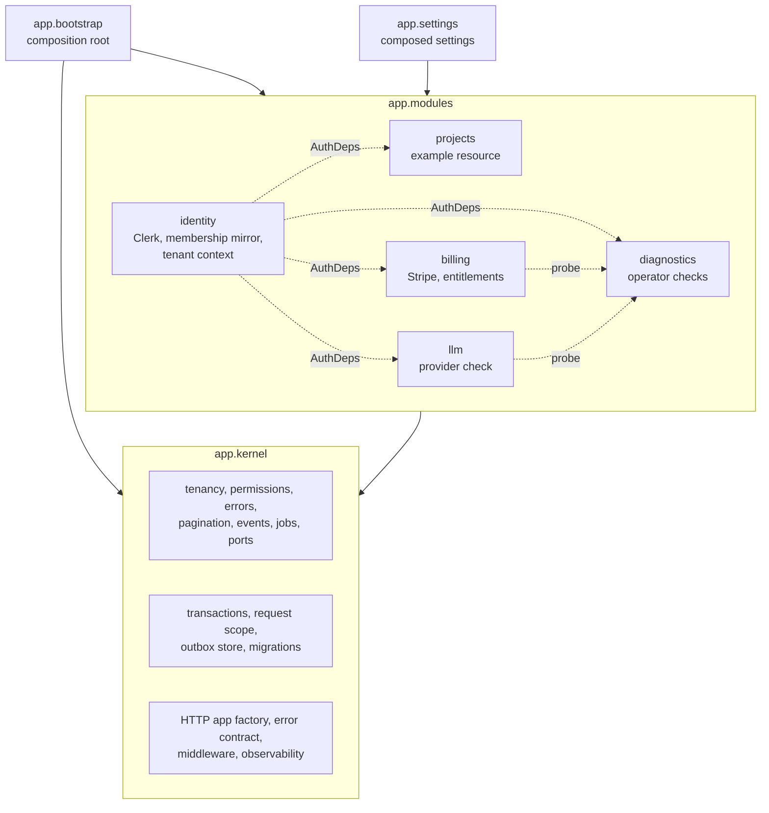
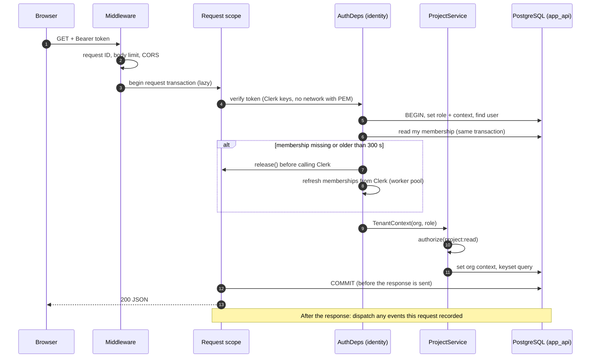
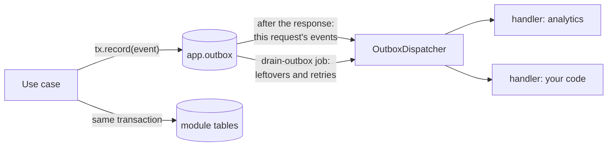

# Architecture

This document describes how the template is built and how to extend it. The decisions behind it are in [ADR-0001](../dev-docs/adr/0001-approved-recommendations.md) (stack, data access, tenancy, billing policy) and [ADR-0003](../dev-docs/adr/0003-modular-architecture.md) (modular monolith, transactions, events, jobs, generator). Requirements are in the [engineering specification](../dev-docs/engineering-implementation-plan.md).

## Principles

- **Secure by default.** Every API operation is authenticated and authorized on the server. Tenants are isolated twice: by the application, and by forced PostgreSQL row-level security (RLS) under non-privileged database roles.
- **A modular monolith.** One deployable API, split into feature modules with explicit boundaries. Modules depend on a shared kernel, never on each other's internals. Splitting a module into its own service later is possible, but not a goal.
- **Ports and adapters.** Use cases depend on protocols. SQL, SDKs, and fakes live in adapters, and the composition root picks the adapters per environment.
- **Boundaries are enforced by tooling, not convention.** Import contracts, architecture tests, query-count budgets, and contract-drift checks fail CI when a boundary is crossed (see [Fitness functions](#fitness-functions)).
- **Measured, not guessed.** Performance choices follow the local measurements in `dev-docs/evidence/`. Targets are each adopter's decision (DEC-003).

## System context


The browser never talks to the database or to Stripe with secret keys (FE-02, DEC-008).

## Containers

| Container | Runs | Holds | Notes |
|---|---|---|---|
| Web app (`apps/web`) | Next.js 16 App Router: Vercel serverless and the browser | Presentation only | Rewrites `/api/v1/*` to the API (same origin). Clerk UI. Generated, typed API client. |
| API (`apps/api`) | FastAPI on Python 3.12 (ASGI) | All business rules | Stateless; one process serves concurrent requests. Vercel deployment is pending DEC-001. |
| PostgreSQL | Local Docker, or Supabase through its transaction pooler | All application state | Two runtime roles (`app_api`, `app_worker`), forced RLS, transactional outbox. |
| Vercel Cron | Platform scheduler | Nothing | Calls the job endpoint (`apps/api/vercel.json`). |

## API components



Dotted arrows are contracts that the composition root passes in. No module imports another module for them:

- **`AuthDeps`** (kernel contract, implemented by identity): FastAPI dependencies that authenticate the caller and resolve the personal or organization context.
- **`IntegrationProbe`** (kernel contract): each module that owns an integration contributes a probe, and diagnostics receives the list.
- **Events:** modules publish to the outbox and subscribe to the event types they care about.

### Module catalogue

| Module | Owns | Routes | Jobs | Events |
|---|---|---|---|---|
| `identity` | Users, the organization-membership mirror, Clerk token and webhook verification, tenant-context resolution | `/me`, `/webhooks/clerk` | `reconcile-memberships` | — |
| `billing` | Customers, subscriptions, the entitlement matrix, price catalog, Stripe | `/entitlement`, `/billing/*`, `/pro/insight`, `/webhooks/stripe` | `reconcile-billing` | publishes `billing.entitlement_changed` |
| `projects` | Example tenant-scoped resource; the generator's reference | `/projects`, `/orgs/{org_id}/projects` | — | publishes `projects.created` |
| `llm` | Provider-agnostic connectivity check with cost bounds | `/llm/check` | — | — |
| `diagnostics` | Operator-only integration report and checks | `/diagnostics/*` | — | — |
| kernel | Health, readiness, outbox, rate limits | `/health`, `/ready`, `/jobs/{name}` | `drain-outbox`, `prune-expired` | dispatches all |

## Module anatomy

Every module has the same files, which is what lets `pnpm new:module` generate one and lets tooling check them:

| Layer | File | May import | Never imports |
|---|---|---|---|
| Wiring | `module.py` | everything in the module, the kernel | other modules (except their `api`) |
| Settings | `settings.py` (optional) | kernel config | anything else in the module |
| Public API | `api.py` (optional) | lower layers | — |
| HTTP | `routes.py` | service, domain, kernel HTTP contracts | adapters, SDKs, kernel infrastructure |
| Adapters | `adapters.py` or `adapters/` | ports, domain, drivers and SDKs | service, routes |
| Probe | `probe.py` (optional) | service, ports, domain | frameworks, adapters |
| Use cases | `service.py` | ports, domain, kernel ports | frameworks, SDKs, adapters, kernel infrastructure |
| Ports | `ports.py` (optional) | domain | everything above |
| Domain | `domain.py` | kernel core only | frameworks, Pydantic, SDKs, everything above |

Rules between modules:

- A module may import another module **only** through its `api.py`. Prefer kernel contracts (`AuthDeps`, events, probes) over direct calls.
- Modules form no import cycles.
- The kernel never imports a module.

## Request lifecycle

An organization-scoped list, `GET /api/v1/orgs/{org_id}/projects`:



Errors anywhere map to RFC 9457 problem details with a stable `code` and the request ID. Stack traces, SQL, and secrets never reach the client.

## Data access

**Roles.** Requests run as `app_api` and system work runs as `app_worker`. Neither role owns tables or has `BYPASSRLS`. Each transaction sets the role, the statement timeout, and the full tenant context (`app.clerk_user_id`, `app.user_id`, `app.org_id`) in **one statement**, which is one round trip.

**Faults.** The server enforces the statement timeout, so it cannot end a call when the server, or a pooler in front of it, stops responding. Every round trip therefore also has a client-side deadline (statement timeout plus connect timeout); past it, the connection is closed and the call fails with `503`. A pooled connection that died while idle (after a pooler restart or failover) fails on its first round trip, before any work has run, so the transaction starts again on another connection. Transaction-mode pooling works because every setting is transaction-local and prepared statements are off. The DEC-001 proof checked this through PgBouncer in transaction mode.

**`Transactions[R]`.** Each module gets transactions that build its own repository: `kernel.transactions(PgProjectRepository)`. A block yields a `Tx` with:

- `tx.repo`: the module's repository;
- `tx.record(event)`: writes to the outbox in the same transaction;
- `tx.audit(entry)`: appends to the audit log;
- `tx.lock_my_role(org_id)`: re-reads and locks the caller's role before a privileged write (TEN-07, NT-06).

**Request-scoped transactions.** Routers that touch only the database opt in. Their whole request is one `app_api` transaction:

- every block in the request joins it;
- the context is re-applied only when it changes;
- a block that raises rolls the request back;
- it commits after the handler returns, **before** the response is sent, so a failed commit is a 503, never a false 201;
- `Transactions.release()` commits early. The identity resolver calls it before contacting Clerk.
- **Admission and commit threads.** A scoped request holds its connection across several threadpool hops. To keep connection holders from starving behind threads that wait for a connection:
  - at most `DATABASE_POOL_MAX_SIZE` scoped requests are admitted at once, and the rest wait asynchronously, holding no thread;
  - the commit runs on its own thread limiter;
  - nested blocks inside a request transaction are refused.

  Under local stress with a 5-connection pool, this took the API from 3% failures and 55 s worst-case latency to no failures and a 1.6 s worst case.

Routes that call external services use explicit short transactions instead: checkout, the portal, LLM, diagnostics, and webhooks.

**Two pools per process.** `DATABASE_POOL_MAX_SIZE` serves `app_api` and `DATABASE_WORKER_POOL_MAX_SIZE` serves `app_worker`. A request holding an API connection that needs worker work (a rate-limit counter, a membership refresh) draws from the other pool, so the pools can never deadlock each other.

**Query budget.** Every key endpoint is tested to issue at most 8 statements, independent of data volume (ARCH-08). PERF-07 (local, 20 ms added per round trip) showed why this matters with a remote database. A personal list took a median of 686 ms with per-setting setup statements, 180 ms after single-statement setup, and 135 ms with the request-scoped transaction. An organization list went from 1,049 ms to 270 ms to 180 ms. Evidence is in `dev-docs/evidence/`.

## Domain events and the outbox



- **Exactly-once recording.** An event row exists if and only if its transaction committed.
- **At-least-once handling.** Handlers run after commit, and a retry re-runs every handler for that event. Make handlers idempotent: key side effects by `event.id`, or make them naturally idempotent.
- **Concurrency.** Events are leased with `FOR UPDATE SKIP LOCKED`, so after-response dispatch in many instances and the job can drain together. A lease that is never completed (the process died) expires and the event is retried. Completion is fenced to the lease: a worker whose lease expired cannot overwrite the outcome recorded by the worker that re-leased the event.
- **Failures.** Retries use exponential backoff (2^attempt seconds, capped at an hour). After `OUTBOX_MAX_ATTEMPTS` the event is marked `dead` and kept for inspection.
- **Retention.** `prune-expired` deletes processed events after `OUTBOX_RETENTION_DAYS` (default 7), because payloads hold internal user IDs.
- **Ordering.** Not guaranteed across events. Handlers must not assume an order.
- **Payloads.** Internal IDs and small facts only: no personal data beyond IDs, no secrets.

To react to an event, subscribe in your module's `module.py`:

```python
kernel.handlers.subscribe(ProjectCreated, "notifications.welcome", service.on_project_created)
```

## Jobs

Jobs are registered in code (`kernel.jobs.register(Job(...))`), and every job must be safe to repeat and to run concurrently with itself. They run through:

- the CLI: `uv run python -m app.cli job` lists jobs, and `job <name>` runs one;
- `GET /api/v1/jobs/<name>` with `Authorization: Bearer <CRON_SECRET>`. This is what Vercel Cron calls, using `apps/api/vercel.json`. A test fails if that file drifts from the registry.

Without `CRON_SECRET`, the endpoint returns 404. Default schedules are daily so the config deploys on any Vercel plan; on plans that allow it, run `drain-outbox` more often.

## Settings

Each module declares its environment variables and validation in `settings.py`. `app/settings.py` composes them into one `Settings` class that validates everything at startup and names bad variables without echoing their values (ENV-03). To add settings to a module, see the docstring in `app/settings.py`.

## Frontend

- **Layout.**
  - `src/app` holds routes and layouts only.
  - `src/features/<feature>` holds feature UI, tests beside it, and a public `index.ts`.
  - `src/ui` holds presentational components with no feature knowledge.
  - `src/lib` holds infrastructure: the API client, analytics, CSP, redaction, error reporting.
- **Boundary rules.** `lib` may not import `ui`, `features`, or `app`. `ui` may not import `features` or `app`. A feature may reach another feature only through its `index.ts`. ESLint `import/no-restricted-paths` enforces them (`apps/web/eslint.boundaries.mjs`). Feature folders are discovered when the config loads, so a new feature is covered without editing it.
- **Typed client.** `src/lib/api/client.ts` wraps `openapi-fetch` over the generated `paths` type. A wrong path, parameter, or body fails `tsc`. Regenerate it with `pnpm contracts` after any API change; CI fails on drift.
- **The server is the authority.** The UI renders the API's decisions (plan, role, entitlement) and never re-derives them.

## Adding a feature

1. Generate a module: `pnpm new:module invoices` (pass `--entity` when the singular is irregular). This creates:
   - the API module;
   - a migration with forced RLS;
   - integration tests for tenancy, authorization, audit, events, and RLS;
   - a web feature with a component test;
   - typed client methods;
   - the wiring in `app/bootstrap.py`.
2. Run `pnpm db:migrate`, `pnpm contracts`, and `pnpm test`.
3. Model your real fields: edit `domain.py`, the migration (before it is applied anywhere shared), `adapters.py`, and `routes.py`.
4. Declare permissions in `domain.py`. They are denied unless a context or role is listed.
5. If other modules need something, prefer an event, or expose a narrow `api.py`.
6. Mount the panel in a page, and add an e2e check for the main flow.

`pnpm test:new-module` (also run in CI) proves that a freshly generated module passes every gate.

## Scaling and performance

- **Stateless API instances.** No module-level mutable state beyond lazily opened, thread-safe pools and SDK clients (ARCH-09). Fluid Compute may serve concurrent requests in one instance.
- **Connections.** Each instance opens at most `DATABASE_POOL_MAX_SIZE + DATABASE_WORKER_POOL_MAX_SIZE` connections. With Supabase, use the transaction pooler: prepared statements are disabled for it, and client connections multiplex onto few server connections. Size the pools from your instance concurrency and the pooler's limits.
- **Round trips over raw speed.** Keep setup to one statement, prefer request scope for database-only routes, and stay within the query-count budget. Keyset pagination keeps list cost flat at any depth.
- **Shared counters** (rate limits, LLM budget) live in PostgreSQL (DEC-011). Move them to a dedicated store only with an ADR, after measurement.
- **Asynchronous work** goes through the outbox. It scales with `SKIP LOCKED` workers; if volume outgrows PostgreSQL, the dispatcher is the seam where a queue can replace it.
- **No caching yet.** Adding a cache requires an ADR with its invalidation and consistency rules.
- **Evidence.** Local PERF-01 to PERF-07 results are in `dev-docs/evidence/`. The run plan and targets worksheet for real environments is `perf/run-plan-template.md`.

## Fitness functions

| Rule | Enforced by |
|---|---|
| Kernel never imports modules or the composition root | import-linter |
| Kernel core and module domains, services, and ports are framework-free | import-linter |
| Every module has the same layers, with nothing undeclared | import-linter `layers` contract (`exhaustive = true`) |
| Modules are acyclic | import-linter `acyclic_siblings` |
| Modules use each other only through `api.py` | `tests/architecture/test_modules.py` |
| Module shape; unique permissions; event types prefixed by module | `tests/architecture/test_modules.py` |
| Every route authenticates unless allowlisted | route-manifest test |
| Bounded statements per request; one transaction for request-scoped routes | query-count and request-scope tests |
| Commit before response; rollback on block error; no context leaks | `tests/integration/test_request_scope.py` |
| Outbox recording, dispatch, retries, dead letters, leases, retention | `tests/integration/test_outbox_jobs.py` |
| Cron config matches the job registry | `tests/integration/test_outbox_jobs.py` |
| API contract and TypeScript types are in sync | `pnpm contracts:check` |
| Generated modules pass every gate | `pnpm test:new-module` |
| Frontend feature boundaries | ESLint `import/no-restricted-paths` (`apps/web/eslint.boundaries.mjs`); `src/boundaries.test.ts` lints real snippets through the real configuration |
